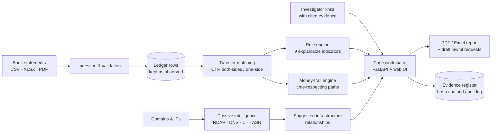

# TRACEINTEL

**From fragmented evidence to connected, explainable, auditable cybercrime intelligence.**
Built for the Rajasthan Police Cyber Security Hackathon 2026, Problem Statement **PS05: Financial Crime Infrastructure & Money-Trail Analysis**.


> Investigation-support tool, not an autonomous decision system. It produces **review-priority indicators** and **possible transaction paths**;
> it never declares guilt or proves fund movement. **Synthetic data only.**

<!-- Add after deploying: **Live demo:** https://YOUR-APP.onrender.com -->
<!-- Add screenshots to docs/screenshots/ and reference them here: money trail, accounts, infrastructure, report -->

## The problem
A victim loses money; it hops through mule accounts while the fraud runs on disposable domains and cloud servers. Investigators receive bank
statements, IPs and domains from different sources in different formats, and must connect them by hand before sending lawful requests.

## What TRACEINTEL does
| Capability | How |
|---|---|
| **Ingest statements** | CSV / XLSX / ruled-table PDF into one schema; per-row validation, balance check, duplicate-UTR detection. Bad rows are flagged, **never dropped**. |
| **Mule-account indicators** | 9 transparent, configurable rules (fan-in/out, rapid pass-through, velocity, 24h turnover, dormant-to-active, layering, circular flow, round figures). Every indicator shows its evidence, UTRs and limitation. |
| **Money trail from a UTR** | Time-respecting multi-hop paths from real records; each transfer stays individual; commingling is flagged; labelled *possible path, not proven fund movement*. |
| **Domain & IP intelligence** | Passive only: RDAP, DNS (with fallback resolver), Certificate Transparency, ASN. Cached, offline-capable, honest per-source status. No scanning or probing. |
| **Financial ↔ digital links** | Entered **only by the investigator**, with explanation + cited source; retract-not-delete; context and *suggested* leads shown with caveats. |
| **Evidence & audit** | Evidence register with SHA-256; hash-chained audit log (tamper-evidence only; not legal chain-of-custody). |
| **Reports & lawful requests** | PDF + Excel report (facts / indicators / suggested / investigator, methodology, limitations) and **draft** information requests for banks, registrars and hosting providers, to be issued by an authorised officer through legal process. |

### Design principles
1. **Observed facts, indicators, inferences and investigator conclusions are always labelled differently.**
2. Two layers: statement rows exactly as seen, and *derived* transfers with provenance (seen in both statements vs one side only).
3. Relationships are never fabricated; shared hosting, CDNs and common name servers are weak leads, never proof.
4. Non-public records (subscriber, KYC, login) are **requested through lawful process, never presented as public data**.
5. Thresholds are configurable (`config.yaml`) and each run stores the config it used.

## Architecture

Modular monolith: Python 3.12, FastAPI, SQLite (stdlib), pandas / openpyxl / pdfplumber, ReportLab, a dependency-free single-file web UI.

## Quick start
```bash
pip install -r requirements.txt
python -m unittest discover -s tests           # 100+ tests
uvicorn traceintel.api:app --reload            # open http://127.0.0.1:8000/ui/  ->  "Load synthetic demo case"
python -m traceintel.report_cli --out reports  # demo PDF + Excel + draft requests without the UI
```
Windows/VS Code users: see [`RUN_GUIDE.md`](RUN_GUIDE.md). Deployment: [`DEPLOY.md`](DEPLOY.md).

**Demo flow (≈3 min):** Load demo case → *Mule Account Intelligence* (click MULE01: why it was flagged) → *Money Trail* (UTR `699999999001`, Trace; dashed = unverified)
→ *Digital Infrastructure* (shared IP/NS between two scam-like domains; the unrelated domain is not linked) → *Financial ↔ Digital Links* (record a cited link)
→ *Evidence & Audit* → *Reports* (PDF, Excel, draft requests).

## Synthetic scenario (planted, with negative controls)
Victim → MULE01 → MULE02 → MULE03 → CASHOUT01, with fan-in (8 senders) and fan-out (5 recipients) at MULE01, a circular flow, a dormant account that wakes up,
round-figure layering, and a **salary account that must not be flagged**. Tests assert the exact accounts and UTRs.

## Project status (honest)
| Area | Status |
|---|---|
| Ingestion, matching, rules, money trail, infra intelligence, case service, reports, drafts, links | Implemented; unit-tested (`tests/`) |
| Web UI | Overview, Accounts, Money Trail, Infrastructure, Evidence & Audit, Reports verified manually in a browser; the Links tab and in-browser upload were added later and need a manual check |
| Real bank statement formats (R4C sample) | **Not yet validated**: parser is mapping-driven; header aliases will need tuning |
| Certificate Transparency (crt.sh) | Implemented; could not be reached from the test environment, so not verified live |
| Authentication / roles | Not implemented (single investigator). **Do not expose with real data** |
| Timestamp correlation with IP-allocation records, cross-case linking, historical/passive DNS | Not implemented |
| Scale (very large statements) | Not load-tested |

## Limitations
Rule indicators can flag legitimate activity; paths are possibilities, not proof; one-sided transfers rely on counterparty text; statement times are assumed
IST unless configured; geolocation/ASN data is indicative. Full list in every generated report (section 9).

## Layout
```
traceintel/      ingest · transfers · rules · trail · links · service · reporting · requests_draft · api · infra/ (enrich, parsers, correlate, cache)
frontend/        single-file web UI served at /ui
tests/           engine, infra, service, report, links
data/synthetic/  generated synthetic statements (python -m traceintel.synthetic)
config.yaml      all thresholds
```

## Ethics & legal
No access to bank systems; no freezing of funds; no active scanning of third-party infrastructure; no real personal data. Draft requests are drafts.
